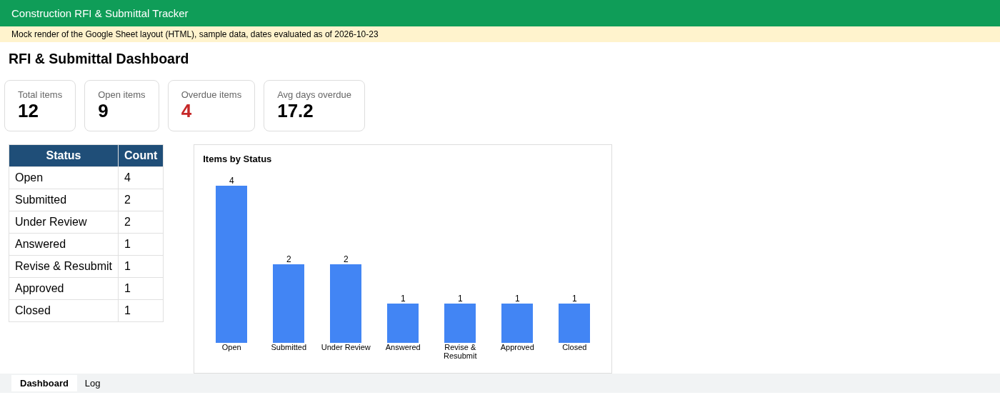
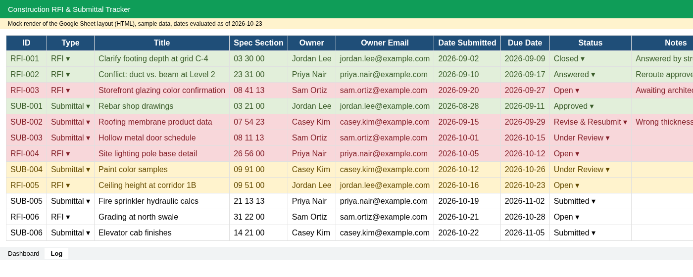
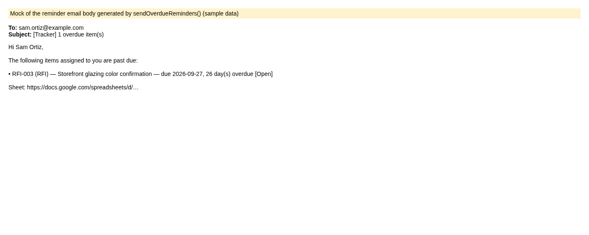

# Construction RFI & Submittal Tracker (Google Sheets + Apps Script)

A ready-to-use tracker for construction RFIs and submittals: dropdown statuses, automatic overdue highlighting, a live dashboard, and **daily email reminders** to item owners.

> All names, emails, and items are fictional sample data.

**Template:** [Make a copy in Google Sheets](https://docs.google.com/spreadsheets/d/1zW7RQXRGdi5oLCzieADu-MYjvjG2_DyoLTuZBR7oa7M/copy)

*Screenshots are HTML mock renders of the sheet layout using the same sample data (not captures of the live Google Sheet).*

## Features
- **Status & type dropdowns** (data validation): Open, Submitted, Under Review, Answered, Revise & Resubmit, Approved, Closed
- **Conditional highlighting:** red = overdue, yellow = due within 3 days, green = closed out
- **Days Overdue** formula column
- **Dashboard tab:** counts by status, total/open/overdue items, average days overdue, column chart
- **Auto-reminders:** `sendOverdueReminders()` groups overdue open items by owner and emails each owner one digest (MailApp). Optional CC to a PM.
- **Daily trigger:** `installDailyTrigger()` schedules the reminder every morning at 7am
- **Custom menu:** *Tracker → Set up sheet / Send overdue reminders now / Enable daily reminders*

## Setup
1. Open the template link above and choose **Make a copy** (or start from a blank sheet and import `sample/sample_items.csv` into a tab named `Log`).
2. **Extensions → Apps Script**, paste `src/Code.gs`. In Project Settings, enable “Show appsscript.json” and paste `src/appsscript.json`.
3. Reload the sheet. Run **Tracker → Set up sheet** (authorize when prompted). This builds the validation, highlighting, and dashboard; it is safe to re-run.
4. Optional: set `CONFIG.CC` to a project manager's email and `CONFIG.REMINDER_HOUR`.
5. Run **Tracker → Enable daily reminders**.

## Files
| Path | What |
|---|---|
| `src/Code.gs` | Apps Script: setup, dashboard, reminders, trigger |
| `src/appsscript.json` | Manifest with minimal scopes |
| `sample/sample_items.csv` | 12 fictional RFIs/submittals |

## Customization I offer
Custom columns, Gmail/Slack notifications, PDF transmittals, multi-project rollups, Procore/CSV imports.

Built by Mario Herrera.
